# Werewolf Dynamics — Analog Collection (v0.9.0)

Analog gear, simulated from the circuit up. Twenty-six free audio plugins (**22 Core + 4 Preview Mode**) built as live circuit solvers — VST3, CLAP, and AU for Windows, macOS, and Linux Beta.

Most "analog modeled" plugins take a static measurement and fit waveshapers over it. These solve the circuit while your audio runs through it: tube bias shifts under load, transformer cores saturate from magnetic flux (so lows saturate before highs), and optical cells remember program history. If a meter moves or a transfer curve bends on screen, the running circuit caused it.

Grab the latest installers and bundles from the **[Itch.io release page](https://xbombjackx.itch.io/analog-collection)** or **[GitHub Releases](https://github.com/xBombjackx/werewolf-dynamics-releases/releases)**.

## Live in Your Browser (8 WebAssembly Plugins + 17 A/B Demos)

Run real C++ plugin engines directly inside your browser using WebAssembly (no uploads, local file drop supported):

- **[WD Opto — Live](https://xbombjackx.github.io/werewolf-dynamics-releases/live/opto.html)** — optical cell chemistry + tube/transformer stage
- **[WD Duress — Live](https://xbombjackx.github.io/werewolf-dynamics-releases/live/duress.html)** — eight curve families, British Mode, residual drive
- **[WD Pre — Live](https://xbombjackx.github.io/werewolf-dynamics-releases/live/pre.html)** — seven preamp circuits behind one stepped input stage
- **[WD FET — Live](https://xbombjackx.github.io/werewolf-dynamics-releases/live/fet.html)** — microsecond JFET limiter + All-Buttons ratio network
- **[WD Tape — Live](https://xbombjackx.github.io/werewolf-dynamics-releases/live/tape.html)** — hysteresis tape machine across 3.75 to 30 ips
- **[WD Echo — Live](https://xbombjackx.github.io/werewolf-dynamics-releases/live/echo.html)** — motor-driven tape loop delay with 3 heads & spring tank
- **[WD Spring — Live](https://xbombjackx.github.io/werewolf-dynamics-releases/live/spring.html)** — dispersive steel spring reverb tank
- **[WD XQ — Live](https://xbombjackx.github.io/werewolf-dynamics-releases/live/xq.html)** — five EQ circuits (Precision, Console E/G, Discrete 550, Inductor 73) with dynamic bands and line-stage drive
- **[17 Sample-Locked A/B Audio Demos](https://xbombjackx.github.io/werewolf-dynamics-releases/demos/)** ([full website tour](https://xbombjackx.github.io/werewolf-dynamics-releases/)) — switch circuits mid-phrase with a 12 ms crossfade, loudness-matched.

## Core Lineup (22 Plugins)

**WD Opto** — optical tube leveling amplifier with T4 photocell memory, two voicings (`WD-2A` tube, `WD-3A` solid-state), and continuous THD/Iron/Tilt controls.

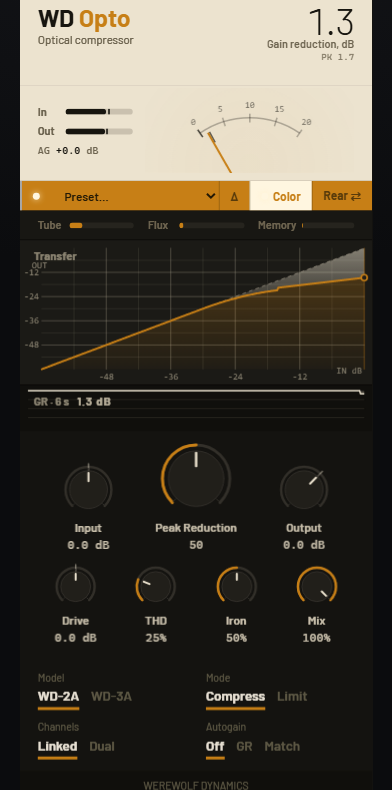

**WD Mu** — variable-mu compressor built around a simulated 6386 push-pull stage, six time constants, front-panel bias control, and rear-panel mismatched tube trims.

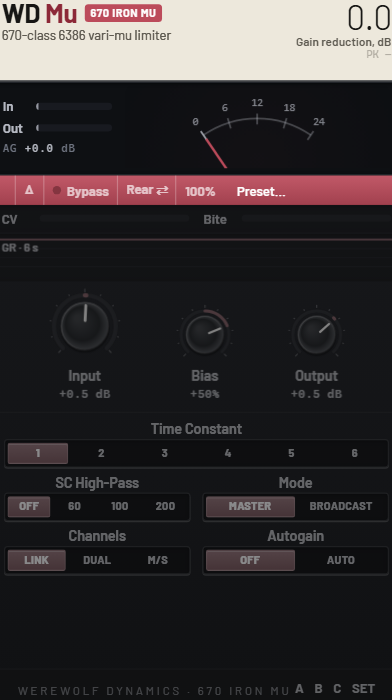

**WD FET** — JFET limiting amplifier spanning four circuit laws, three output stages (`Class A`, `Push-Pull`, `Triode`), microsecond attack, and coupled All-Buttons resistor ladder.

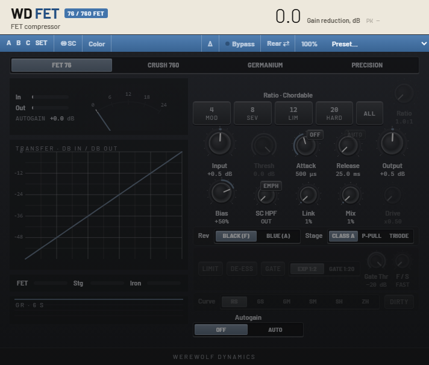

**WD VCA** — stereo VCA bus compressor offering Console Bus, RMS Punch, and American discrete bus thrust detectors on one gain cell.

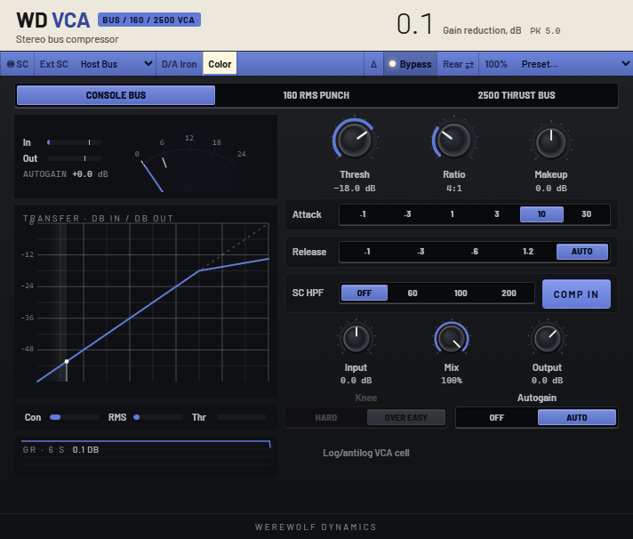

**WD Duress** — eight-curve compressor family from `1:1` warm saturation through opto-style `10:1` and `Nuke` brickwall crush, with `Dist 2`/`Dist 3` modes and British Mode.

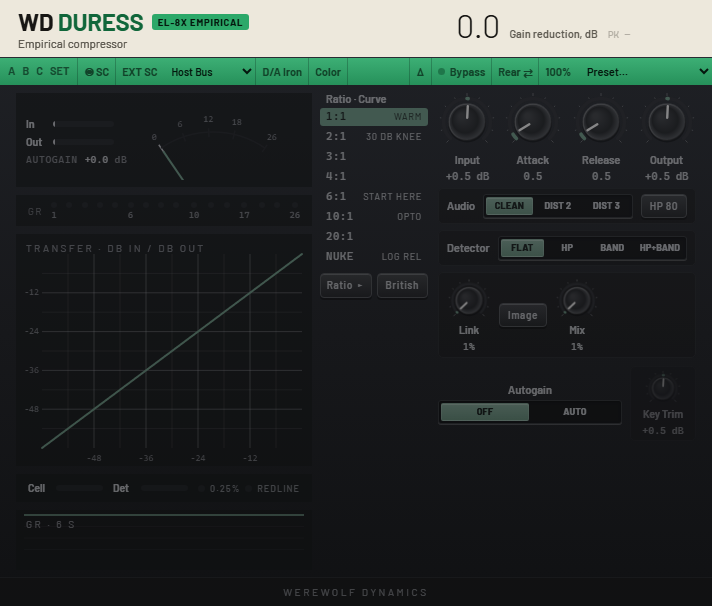

**WD Clamp** — three reorderable compressor slots (`Opto`, `Mu`, `FET`, `VCA`) on one shared supply rail, live measured transfer curves, and a `-10 / -20 dB` input pad.

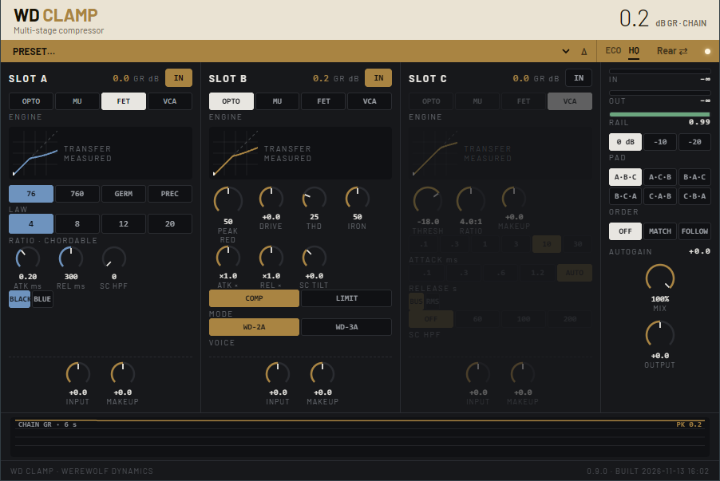

**WD Tec** — passive program low/high shelf and midrange EQ sections coupled through live magnetic inductor cores and push-pull tube makeup.

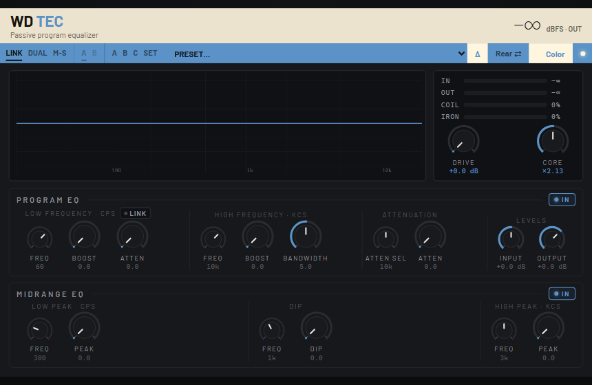

**WD XQ** — one parametric EQ face driving five distinct topologies (clean digital, two consoles, stepped American graphic/bell, and 1973 inductor law) with per-band dynamic mode.

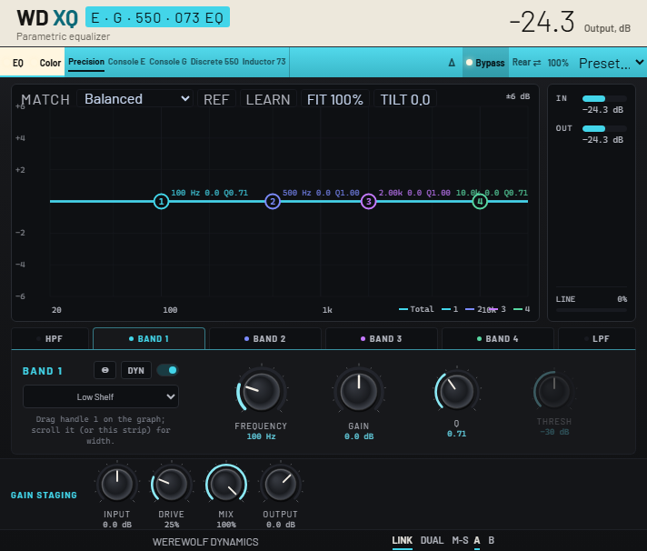

**WD Pre** — seven preamp topologies behind one stepped input stage (`Precision`, `Class A 73`, `Op-Amp 12`, `Tube 76`, `Porta`, `Clean E`, `Tube Tone`) with `Match` autogain.

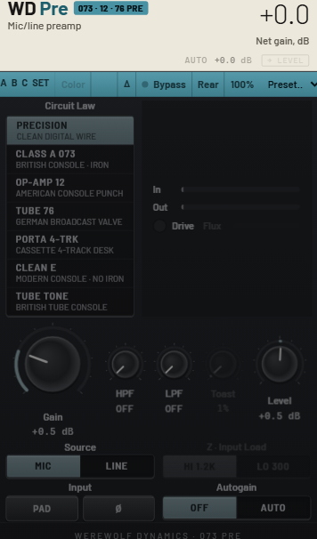

**WD Tape** — full studio and portable magnetic tape machine modeling record electronics, hysteresis core, bias oscillator, head bump, gap loss, and transport wow/flutter.

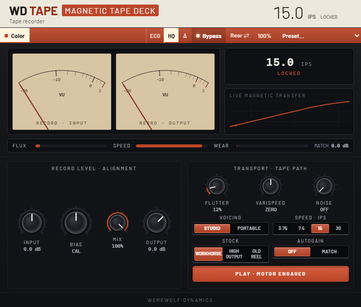

**WD AX** — phase-aligned harmonic exciter adding upper sidebands and decay-weighted low-end weight without boosting EQ peaks.

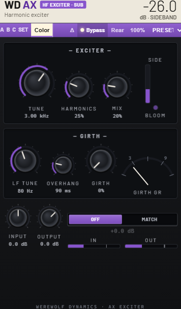

**WD 361** — single-ended four-band upward compander encoder and decode processor spanning `A-Type`, `Broadband`, and treble `B-Type` topologies.

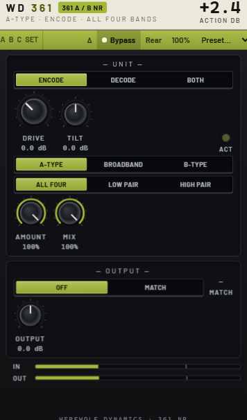

**WD Strip** — standalone channel strip uniting 7 preamps, desk/parametric EQ curves, 5 compressor engines, gate, tilt, and shared internal power supply.

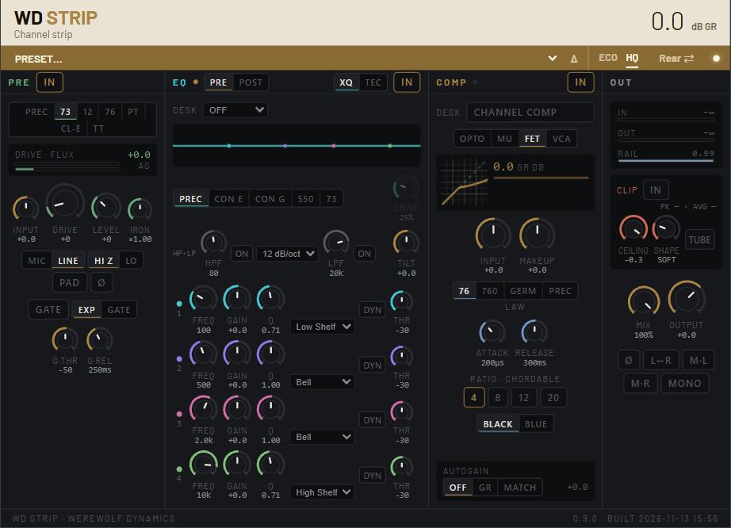

**WD Summer Channel** — zero-latency per-track desk channel with five selectable console topologies, deterministic component spread, and loudness-neutral overdrive.

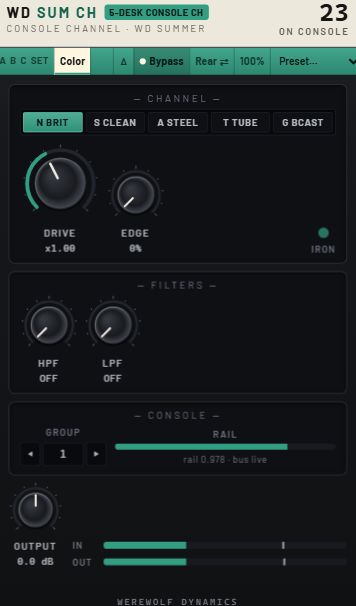

**WD Summer** — summing bus partner receiving live channel loading and power-rail sag from linked `WD Summer Channel` tracks.

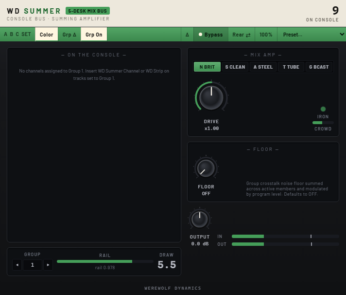

**WD Rack** — cross-instance chassis coordinator sharing power rail sag, neighbor bleed, reorderable slot routing, and timeline-locked PSU ripple across up to 8 frames.

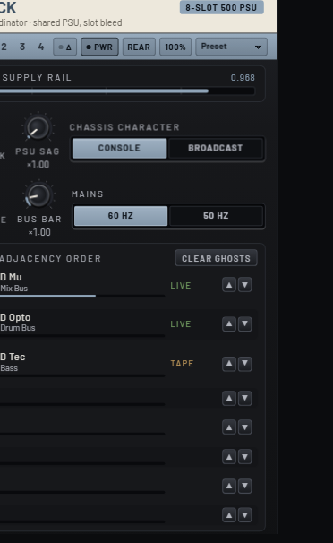

**WD Echo** — motor-driven continuous magnetic tape loop delay with three repro heads, physical splice modulation, spring reverb tank, and Forward/Palindrome/Reverse arrow.

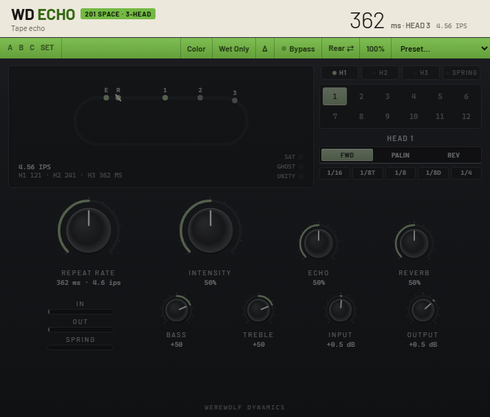

**WD Brigade** — analog bucket-brigade delay where delay length sets the clock rate and naturally closes reconstruction filters into dark repeats.

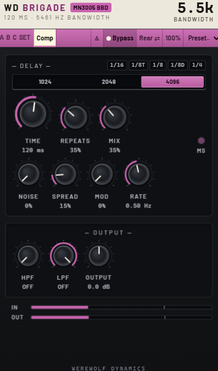

**WD Spring** — physical dispersive steel spring reverb across `Combo Pan`, `Studio Outboard`, and `Tall Console` tanks with nonlinear spring tension chirp.

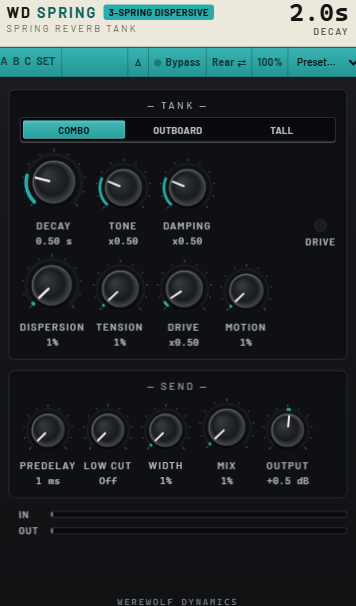

**WD Span** — difference-channel transformer stereo widener where saturating lows tighten toward center while mono fold stays bit-exact.

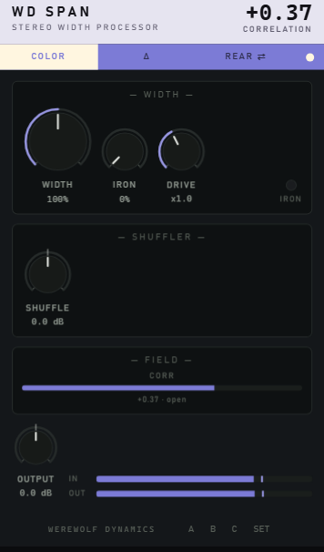

**WD Delta Send / Return** — auto-correlated delay finder, loudness-matched chain delta monitor, and clickless chain bypass for any third-party or WD plugin chain.

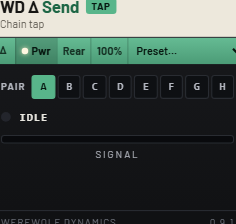 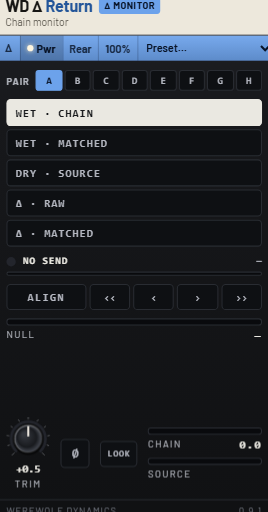

## Preview Mode (4 New Plugins in v0.9.0)

Included in all v0.9.0 bundles for mixing while visual polish and edge behaviors continue toward v1.0:

**WD Horse Girl** — linked two-channel spectral sculptor operating across `LO / HI`, `MID / SIDE`, or `LEFT / RIGHT` axes with live energy blobs and zone listener telemetry.

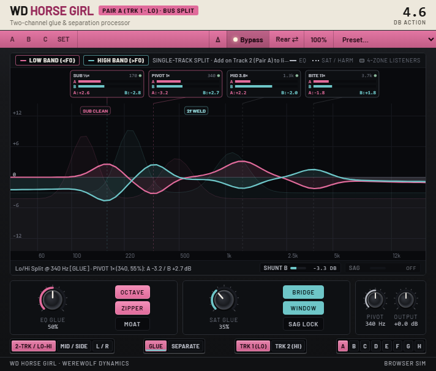

**WD Damper** — adaptive resonance suppressor separating sharp narrow ringing lines from wide intentional vocal and mix weight across 16 smoothed bands.

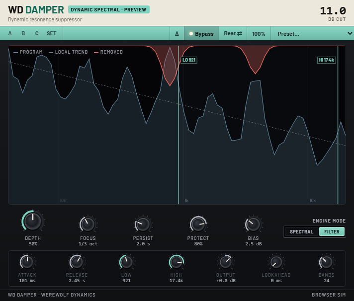

**WD Annihilator** — three-band saturation lab running independent analog destruction circuits (`Triode`, `Diode`, `Negative Iron`, `Tape`, `Wreck`) on one power rail.

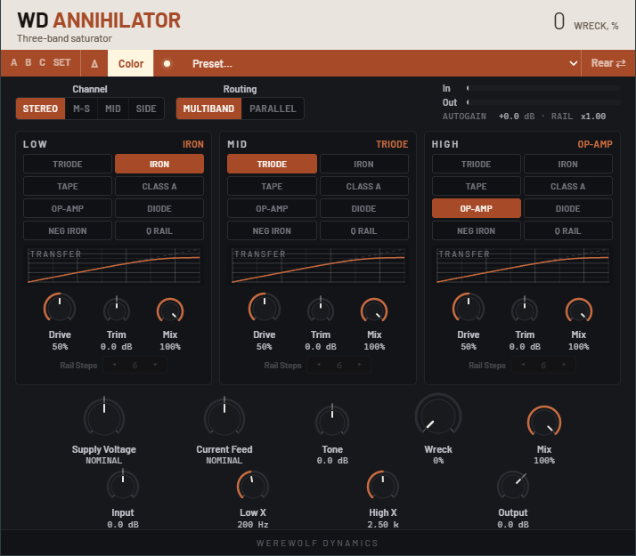

**WD VU** — calibrated ballistic analog VU and PPM peak meter bridge with selectable studio headroom reference points.

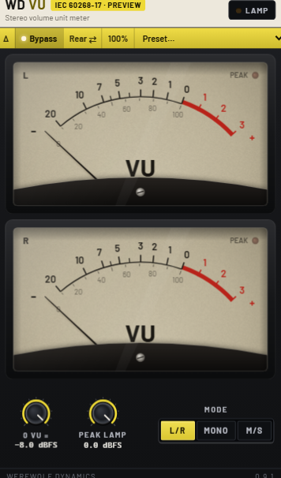

## Requirements & Install

- **Windows 10 / 11 (64-bit VST3 + CLAP):** Run `WerewolfDynamics-v0.9.0-Windows-Installer.exe`, or copy `.vst3` bundles into `C:\Program Files\Common Files\VST3` and `.clap` files into `C:\Program Files\Common Files\CLAP`.
- **macOS 10.15+ (Universal VST3 + AU):** Copy `.vst3` into `/Library/Audio/Plug-Ins/VST3` and `.component` into `/Library/Audio/Plug-Ins/Components`, then run the single `xattr` quarantine command inside `INSTALL.txt` (these builds are not notarized yet).
- **Linux x86_64 (Beta, VST3 + CLAP):** Requires glibc 2.35+ and WebKitGTK 4.1 (`sudo apt install libwebkit2gtk-4.1-0`). Extract into `~/.vst3` and `~/.clap`.

## Host Notes

- **Latency & PDC behavior:** 25 of 26 plugins hold constant latency across all parameter moves during playback so DAW plugin delay compensation never drops out. Only `WD Delta Return` updates reported delay (on the message thread) when toggling `LOOK` (`0` vs. `850 ms` lookahead). In Bitwig, `WD Delta Return` is best used in VST3 format while toggling `LOOK`; `WD Pre` and `WD Damper` set sample-rate latency strictly at `prepareToPlay` and hold constant during playback.
- **Direct keyboard entry:** Double-click any parameter readout to type an exact numerical value (`k`, `kHz`, `Hz`, `dB`, `ms`, `s`, `%`).
- **Guides & verification:** See [docs/RACK_GUIDE.md](docs/RACK_GUIDE.md) and [docs/ACCURACY.md](docs/ACCURACY.md).

## Bugs & License

Open an [issue](../../issues) with your DAW, sample rate, OS, and plugin version.

Free to use for personal and commercial music production; please link here instead of re-hosting the binaries — see [LICENSE.txt](LICENSE.txt). Built with [JUCE](https://juce.com) and the Steinberg VST 3 SDK. VST is a registered trademark of Steinberg Media Technologies GmbH.
